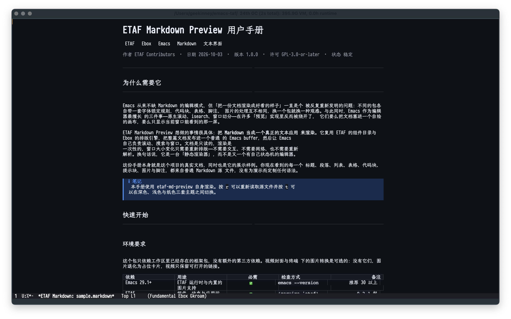

# ETAF Markdown Preview

ETAF Markdown Preview renders a local Markdown document as a modern reading
view inside Emacs. It draws the document with [ETAF](https://github.com/emacs-taf/etaf)
components and the [Ebox](https://github.com/emacs-taf/ebox) renderer: a
centered reading measure, a typographic heading scale, fenced code blocks with
language tags, blockquotes, nested lists, task markers, pipe tables, thematic
breaks, numbered footnotes, clickable links, and local image and video cards.
The whole document publishes into one ordinary Emacs buffer, so native
scrolling, isearch and window splitting keep working.



## Capabilities

- CommonMark blocks and inlines: ATX and Setext headings, paragraphs, emphasis
  and strong emphasis, strikethrough, inline code, links (inline, reference and
  shortcut), autolinks, images, fenced and indented code, blockquotes, nested
  ordered/unordered lists, thematic breaks and character references.
- GitHub extensions: pipe tables with alignment, task list items, bare URL
  autolinks and numbered footnotes.
- GitHub alerts (`> [!NOTE]` and friends) render as titled callout blocks.
- A `:flavor` argument selects `gfm` (default), `commonmark`, or a feature
  plist that toggles individual extensions.
- YAML front matter is stripped from the body and feeds the document title.
- Local images render through ETAF's image Host (graphics in a graphical
  frame, terminal conversion otherwise); a local video starts as a still
  poster, and RET (or a click) mounts ETAF's native video Component to play it
  in place, toggling play/pause on later presses.  Without ffmpeg the card
  keeps the poster and opens the video in the system player.
- Links open in the browser, jump to in-document headings, or open local files;
  a missing media file becomes a labeled card instead of an error.
- Three fixed palettes (dark, light and sepia) plus a face-derived default
  (`etaf-md-preview-theme' = `auto') that follows the active Emacs theme and
  paints no page background; all colors are published as `:ui-*` theme tokens
  so shared ETAF UI components follow the preview.  A floating panel's
  title-bar switch writes the same theme cell, so it can pin `亮` / `暗` /
  `纸` or return to `随` and the document repaints with the panel.
- Outline navigation (`n`/`p`, `C-c j`), imenu integration, reloading (`r`), an
  adjustable maximum reading measure (`[`/`]`) and native scrolling. The
  measure keeps a two-cell gutter on each side, so even a window narrower than
  the measure starts its text off the edge. A window resize reflows through
  the framework's viewport update without rebuilding the view.
- A preview opened from a file follows that file: saving it, or changing it on
  disk from another program, repaints the document on its own and keeps the
  reader in the section it was reading, so an editor and its preview sit side
  by side. `r` still reloads on demand.
- Four user options: `etaf-md-preview-theme`, `etaf-md-preview-flavor`,
  `etaf-md-preview-width-min` and `etaf-md-preview-width-max`.

## Prerequisites

| Requirement | Why | Check |
| --- | --- | --- |
| Emacs 29.1 or newer | the ETAF runtime and Ebox | `emacs --version` |
| ETAF, ETAF UI, Ebox and ECSS on `load-path` | rendering and the component catalog | see Installation |
| ffmpeg (optional) | video playback and terminal image conversion | `ffmpeg -version` |

## Installation

Clone this repository next to the framework checkouts so the directories are
siblings, then add each repository root to `load-path` and require the entry:

```elisp
(add-to-list 'load-path "/path/to/emacs-taf/ecss")
(add-to-list 'load-path "/path/to/emacs-taf/ebox")
(add-to-list 'load-path "/path/to/emacs-taf/etaf-ui")
(add-to-list 'load-path "/path/to/emacs-taf/etaf")
(add-to-list 'load-path "/path/to/emacs-taf/etaf-md-preview")
(require 'etaf-md-preview)
```

`M-x etaf-md-preview-open` then prompts for a file. A package installation that
exposes the root entry through package.el does not need the manual
`add-to-list` for this repository.

## Usage

```
M-x etaf-md-preview-open RET README.md RET
```

| Key | Action |
| --- | --- |
| `n` / `p` | next / previous heading |
| `C-c j` | choose a heading |
| `RET` or mouse-1 | activate the link or image under point; play or pause a video |
| `r` | re-read and repaint the document |
| `t` | cycle dark / light / sepia |
| `[` / `]` | narrow / widen the reading measure |
| `?` / `C-c h` | searchable help inside the preview |
| `q` | close the preview |
| `C-s`, `C-v`, wheel | native isearch and scrolling |

Help follows the preview's theme without splitting its window. `/` searches
the effective bindings; Escape leaves search editing before closing help.
Clicking the dimmed background also closes it and restores the previous focus.

## Development

```sh
make check            # structure, compilation, API bindings, acceptance
make benchmark        # batch render baseline for a generated large document
```

See [docs/manual.md](docs/manual.md) for workflows, the supported syntax and
scripting, and [docs/architecture.md](docs/architecture.md) for the module
layout and the rendering decisions.
