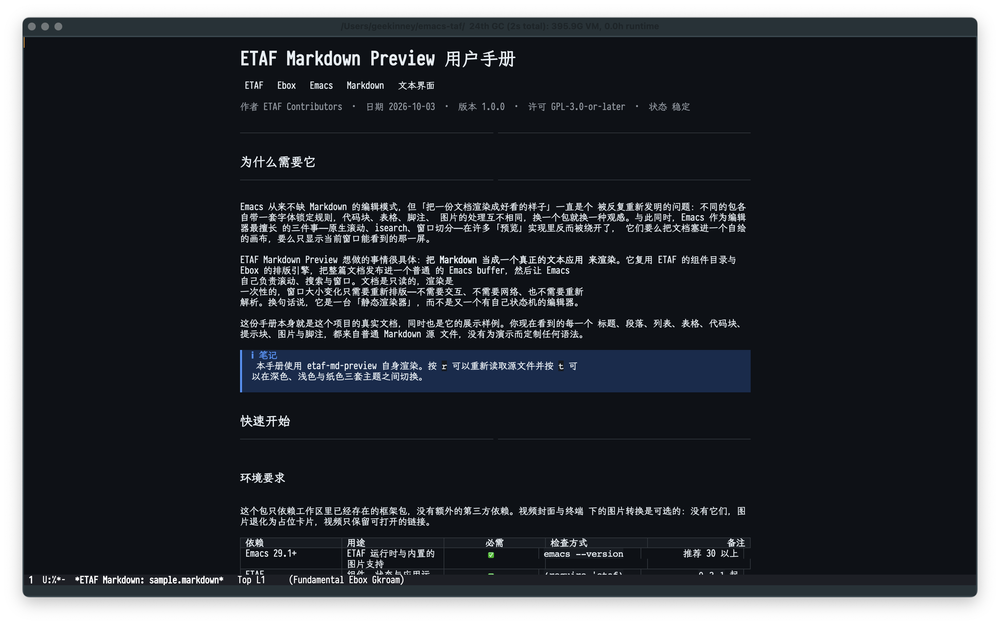
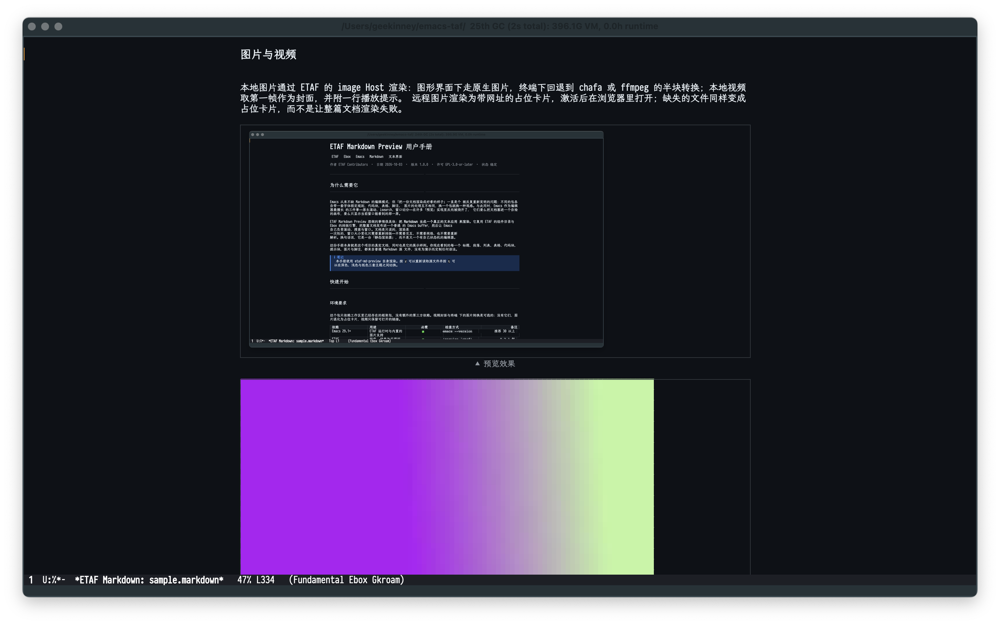

# 一年运维手记

这台机器原本放在书架最下层，屏幕排线早就断了，风扇一转就吵。去年冬天我把它翻出来，插上网线，装上 Debian，当作家里的服务主机。到今年十月，它托管着十四个服务、两块硬盘、一条备份链路，以及七个月的连续运行记录。

写下这份手记时，我尽量只记录真实发生过的事。有些决定当时看来聪明，事后被证明是麻烦的开端；有些偷懒的做法反倒一直没出问题。读的人不必照抄，抄错了也别怪我。

> 一台自建服务器最贵的成本，不是电费，也不是硬盘，而是你在凌晨两点被叫醒的次数。
>
> ——我自己的运维总结，第 N 次失眠之后

## 一、硬件清单与选型

机器的型号是 ThinkPad T480，2018 年的机器，i5-8250U，16 GB 内存，一块 512 GB 的 NVMe 固态。买来时是主力办公机，后来换了台 Mac，它就闲置了。用它省下了买 NUC 的钱，代价是笔记本的散热设计不适合长期满负荷运行。

| 部件 | 型号 | 现状 | 备注 |
| --- | --- | --- | --- |
| CPU | Intel i5-8250U | 4 核 8 线程，常年 30% 以下 | 限频到 1.6 GHz 后风扇安静很多 |
| 内存 | 板载 8 GB + 一条 8 GB | 16 GB | 板载那条没法换，选型时吃过亏 |
| 系统盘 | WD SN520 512 GB | 剩余 180 GB | 原厂盘，跑了 6 年，健康度 92% |
| 数据盘 | 外置 USB 3.0 硬盘盒 + 4 TB 机械盘 | 剩余 1.2 TB | 每晚会转，声音有点大 |
| 网卡 | 有线千兆 | 单口 | 无线卡拆了省电 |
| 电源 | 原装 65 W 适配器 | 常年插电 | 电池已拆，防鼓包 |
| 机位 | 书架第二层，靠墙 | 环境温度 24-30 度 | 夏天要开小风扇 |

选型时我列了三条硬要求：内存至少 16 GB，能插一块 4 TB 硬盘，有千兆网口。软要求是噪音低、功耗低、随便摔一摔不会坏。后来的经历说明第三条硬要求最值钱。

**功耗实测**：待机 8 W，跑备份时 21 W，跑一次全量索引 34 W。按家里的电价算，一年电费不到 120 元。比起托管在云上的同规格实例，这个数字看起来很舒服，但它没算上我投入的周末。

*顺带说一句*，笔记本做服务器有个隐性好处：自带 UPS。小区停过两次电，机器靠电池撑过了电压波动，虽然我最后把电池拆了。

## 二、系统安装与分区

系统用的是 Debian 12，最小化安装。装系统那天我犯的第一个错误，是随手选了默认的 LVM 布局，然后花了两小时才把根分区扩到该有的大小。

安装后立刻做的事，按顺序排：

1. 建一个普通用户，加入 `sudo` 组，禁止 root 直接登录 SSH。
2. 换掉默认的 SSH 端口，启用密钥登录，关掉密码认证。
3. 装 `unattended-upgrades`，让它只装安全更新。
4. 设时区，装 `chrony`，确认时间同步正常。
5. 关掉不用的服务：`cups`、`avahi-daemon`、`bluetooth`。
6. 把 `journald` 的持久化打开，限制日志总量。
7. 做第一次快照，写下恢复步骤。

第三步做过一次调整。默认配置会重启服务，但不会重启内核；我改成自动重启，接受偶尔的意外重启，换取安全补丁及时生效。

```bash
# 关掉不需要的服务
sudo systemctl disable --now cups avahi-daemon bluetooth

# 限制 journald 占用的空间
sudo sed -i 's/^#\?SystemMaxUse=.*/SystemMaxUse=1G/' /etc/systemd/journald.conf
sudo systemctl restart systemd-journald

# 确认时间同步
chronyc tracking | head -5
```

> [!NOTE]
> 关掉 `avahi-daemon` 之后，局域网里的 `.local` 域名就不解析了。
> 如果你靠 `nas.local` 访问别的设备，先想清楚再关。

分区最后长这样：

| 挂载点 | 大小 | 文件系统 | 说明 |
| --- | ---: | --- | --- |
| `/` | 60 GB | ext4 | 系统和容器镜像 |
| `/var` | 40 GB | ext4 | 日志、缓存、数据库 |
| `/srv` | 剩余 | ext4 | 服务数据，单独挂载便于备份 |
| swap | 8 GB | swapfile | 只在内存吃紧时用 |

`/var` 单独分区是吃过亏的：有一次日志写满根分区，整台机器进不了图形界面，SSH 也登不上，只能接显示器救回来。分开之后，同样的故障最多让日志服务挂掉。

## 三、网络：桥接、VLAN 与 DNS

家里的网络拓扑三年里改了四次。现在的样子是：光猫桥接，主路由拨号，服务器接在主路由的第二个网口，固定 IP `192.168.31.9`。第二块网卡不存在，所以服务器只在一个网段里，这省掉了很多麻烦。

DNS 走过两个阶段。最开始时用路由器的内置解析，后来发现它不支持自定义上游的分流，就把解析交给服务器上的 `dnsmasq`。再后来为了做广告拦截，换成了 `AdGuard Home`，界面好用，规则也好维护。

拓扑部分用列表记：

- 光猫（桥接模式）
  - 只做光电转换，关掉自带的 DHCP 与 NAT
- 主路由（192.168.31.1）
  - 拨号，开 DHCP，把服务器的 MAC 绑定到固定 IP
  - 防火墙只放行 22 与 443 两个入站端口
- 交换机（千兆，8 口）
  - 连接服务器、电视盒子、打印机、两台台式机
- 无线接入点（两个，同一 SSID）
  - 一个在主卧，一个在客厅，都走有线回程
- 服务器（192.168.31.9）
  - `dnsmasq` 与 `AdGuard Home` 在这里，DHCP 的下发 DNS 指向它

改 DNS 那天最折腾的一点：DHCP 下发的 DNS 要改成服务器的 IP，但服务器自己的解析不能指回自己，否则机器一重启就全家断网。解决办法是给服务器单独配上游，加上 `127.0.0.1` 之外的三个公共解析器。

```
上游解析器优先级：
1. 运营商 DNS（快，但会劫持不存在的域名）
2. 223.5.5.5
3. 1.1.1.1
4. 服务器本地缓存
```

配置的片段如下，`dnsmasq` 只做缓存和本地域名，真正的过滤交给上层：

```conf
# /etc/dnsmasq.d/local.conf
domain-needed
bogus-priv
cache-size=1000
server=127.0.0.1#5335
address=/nas.home/192.168.31.9
```

> 有次我把 `server=` 写成了 `server=127.0.0.1`，漏掉了端口，结果整台机器的解析进了死循环。
> 表现是 `ping baidu.com` 报 "Temporary failure in name resolution"，而 `ping 1.1.1.1` 正常。
> 记住这个组合，下次看到能省半小时。

局域网里还有几个固定域名，都用 `address=` 直接指过去：`nas.home`、`router.home`、`printer.home`。这些名字不经过 DNS 缓存，改完立刻生效。

关于 IPv6，我试过两次，都退回来了。第一次是光猫的 PD 前缀每次重拨都变，动态 DNS 跟不上；第二次是部分服务监听了 IPv6，防火墙规则没跟上，等于把内部端口暴露在外。现在的做法是关掉 IPv6 的入站，只留出站。

## 四、存储：单盘、快照与备份

数据盘只有一块，这是我最不放心的部分。四 TB 的机械盘，装满了照片、文档、音乐和一堆下载的安装包。没有 RAID，没有冗余，全靠备份活着。

备份分三层：

- **第一层，文件级同步**：每晚 2 点，`restic` 把 `/srv` 增量推到外置硬盘的另一个分区。
- **第二层，异地备份**：每周日，把最近一次的仓库打包加密，传到云端对象存储。
- **第三层，冷备**：每月一次，把关键目录（照片、文档、密码库）写到一块移动硬盘，放在父母家。

各层的覆盖范围和恢复时间差别很大：

| 层 | 覆盖内容 | 频率 | 恢复耗时 | 校验方式 |
| --- | --- | --- | ---: | --- |
| 第一层 | 全部 `/srv` | 每晚 | 20 分钟 | 每周自动 `restic check` |
| 第二层 | 第一层仓库 | 每周 | 2 小时 | 每月一次抽样下载 |
| 第三层 | 照片、文档、密码库 | 每月 | 半天 | 人工打开确认 |

第一层用的是 `restic`，选它主要因为增量快照不依赖文件系统特性，换机器也能还原。命令很简单，麻烦在于记住密码。

```bash
# 备份
restic -r /mnt/backup/restic backup /srv \
  --exclude-caches --exclude '/srv/downloads' \
  --tag nightly

# 保留策略：每天 7 份，每周 4 份，每月 6 份
restic -r /mnt/backup/restic forget --keep-daily 7 --keep-weekly 4 --keep-monthly 6 --prune

# 校验
restic -r /mnt/backup/restic check --read-data-subset=5%
```

> [!WARNING]
> `--prune` 会真的删数据。
> 第一次跑之前，先 `forget` 一遍看看它打算删哪些快照，确认没问题再加 `--prune`。

存储健康检查写在每周的清单里：

- [x] `smartctl -a` 看重新分配扇区计数
- [x] `df -h` 确认没有分区超过 85%
- [x] `restic snapshots` 确认最近一次备份存在
- [ ] 每季度：`restic check --read-data` 全量校验（上次是六月）
- [ ] 每半年：拔下硬盘盒，换根 USB 线试试

最后一个没打勾的项目拖了四个月。这类"没出事所以不重要"的检查，往往就是下次出事的入口。

## 五、服务编排：systemd 单元与非容器化

一开始我用 Docker，后来大部分服务改成了原生 systemd 单元。原因不浪漫：16 GB 内存里，容器层的额外开销不算大，但排查问题时要多穿一层，深夜不值得。

现在还在容器里的只有两个：一个是需要特定运行时的应用，一个是我不想碰依赖树的东西。

一个典型的 systemd 单元长这样：

```ini
[Unit]
Description=Wiki service
After=network-online.target
Wants=network-online.target

[Service]
Type=simple
User=wiki
Group=wiki
WorkingDirectory=/srv/wiki
ExecStart=/srv/wiki/bin/wiki --config /srv/wiki/config.toml
Restart=on-failure
RestartSec=5

# 沙箱
NoNewPrivileges=true
PrivateTmp=true
ProtectSystem=strict
ProtectHome=true
ReadWritePaths=/srv/wiki/data

[Install]
WantedBy=multi-user.target
```

沙箱那几行是分三次加上的。第一次只加了 `NoNewPrivileges`，服务正常；第二次加 `ProtectSystem=strict`，服务起不来，因为它在 `/var/lib` 下写缓存；第三次把缓存目录挪进 `/srv/wiki/data`，顺手把 `ReadWritePaths` 收窄到一条。

服务清单（按启动顺序）：

1. 基础层
   - `ssh`、`chrony`、`systemd-timesyncd`（二选一，我留了 `chrony`）
   - `dnsmasq`、`AdGuard Home`
2. 数据层
   - `postgresql`、`redis`、`minio`
3. 应用层
   - `wiki`、`gitea`、`miniflux`、`navidrome`
   - `immich`（容器）、`paperless`（容器）
4. 运维层
   - `prometheus`、`grafana`、`loki`
   - `restic` 的定时器、`smartd`

启动顺序靠 `After=` 与 `Wants=` 表达，但真正的依赖只有一处：应用要在数据库之后。其余都是"最好如此"，不是"必须如此"，所以我没写死。

> [!TIP]
> 用 `systemctl list-dependencies --reverse <unit>` 看谁依赖你，比翻配置快。

有个细节值得记：`Restart=on-failure` 配上 `RestartSec=5`，会让崩溃的服务每五秒重启一次，日志刷得飞快。给会崩溃的服务加上 `StartLimitBurst=5` 与 `StartLimitIntervalSec=300`，五次之内放弃，等人来看。

## 六、反向代理与 TLS

对外只有两个端口：22 和 443。所有 HTTP 服务都藏在反向代理后面。代理换过两次：先是 `nginx`，后来换成 `Caddy`，主要为了自动证书。

证书用 Let's Encrypt，通过 DNS-01 验证签发，原因是 80 端口被封，HTTP-01 走不通。DNS 记录的 API 密钥放在 root 才读得到的位置，代理以 `cap_net_bind_service` 运行，不用整个进程跑 root。

`Caddyfile` 的片段：

```caddy
{
    email me@example.com
    acme_dns cloudflare {env.CF_API_TOKEN}
}

wiki.example.com {
    encode zstd gzip
    reverse_proxy 127.0.0.1:8080
}

photos.example.com {
    encode zstd gzip
    reverse_proxy 127.0.0.1:2283
}

files.example.com {
    root * /srv/files
    file_server browse
}
```

证书续期失败过一次，原因很低级：`CF_API_TOKEN` 写在 `EnvironmentFile` 里，那个文件有尾随空格，token 末尾多了一个空格，验证一直失败。日志里只写"unauthorized"，看不出是空格。

对外暴露的服务都加了一层认证：

| 服务 | 域名 | 认证方式 | 备注 |
| --- | --- | --- | --- |
| 笔记 | `wiki.example.com` | 应用自带登录 | 双因素已开 |
| 相册 | `photos.example.com` | 应用自带登录 | 家人共享账号 |
| 文件 | `files.example.com` | 代理层 basic auth | 只读目录 |
| 监控 | `grafana.example.com` | 代理层 basic auth + IP 白名单 | 只允许家里网段 |
| 定时任务面板 | `cron.example.com` | 代理层 basic auth | 很少用，考虑关掉 |

图片资源的处理也有坑。预览器、灯箱这类前端组件会自己请求图片，如果图片走代理层的 basic auth，浏览器不会带上凭据，结果一片空白。解决办法是把只读目录放到不需要认证的子路径。



外网访问的入口，我保留了云主机上的一台中转，配置档在这里 [反向代理配置][proxy-ref]。中转只做 TCP 转发，不解析内容，这样家里换 IP 也不影响。

[proxy-ref]: https://example.com/notes/reverse-proxy "中转与回源配置说明"

### TLS 的几个数字

- 证书有效期：90 天，续期在到期前 30 天开始尝试
- 握手延迟：家里到中转约 38 ms，中转回源约 12 ms
- 加密套件：只留 TLS 1.2 与 1.3，去掉 CBC
- 会话复用：开启，重复握手降到 1 个 RTT

## 七、监控与告警

监控分三块：指标、日志、心跳。指标用 Prometheus 抓取，日志进 Loki，心跳靠一个每分钟 ping 一次的外部服务。

我一度把监控做得很复杂，抓了四十多个指标，画了十几张图。真正用上的只有四张：磁盘剩余、内存与 swap、服务存活、备份新鲜度。其余图在故障时没人看，在日常里制造焦虑。

告警规则只留了六条：

1. 磁盘任一分区剩余低于 10%
2. swap 使用超过 4 GB 持续 10 分钟
3. 关键服务连续 3 次抓取失败
4. 备份超过 36 小时没有新快照
5. 证书剩余有效期低于 14 天
6. 系统负载 15 分钟均值超过核数的两倍

```yaml
# prometheus/rules/backup.yml
groups:
  - name: backup
    rules:
      - alert: BackupStale
        expr: time() - restic_last_snapshot_timestamp_seconds > 129600
        for: 10m
        labels:
          severity: warning
        annotations:
          summary: "备份超过 36 小时没有更新"
          description: "最近一次快照在 {{ $value | humanizeDuration }} 之前"
```

告警走 Telegram，静默规则写在配置里：夜间 0 点到 7 点，只有 `severity=critical` 才推送。这条规则救过我的睡眠，也让我错过一次磁盘满的预警，第二天早上才发现。

> [!IMPORTANT]
> 静默期内发生的问题不会消失，只会延后被发现。
> 设静默时顺手加一条早八点的汇总，别让事情真的沉下去。

内存那一条改过一次阈值。swap 用到 4 GB 时机器还能跑，用到 6 GB 就开始明显变慢，SSH 命令要等两三秒才回。现在阈值设在 4 GB，同时把 `vm.swappiness` 从 60 降到 10，让它更愿意回收页缓存。

心跳用的是一个免费的外部检查服务，每分钟请求一次 `/health`。它比我自己写的 cron 可靠，因为它在外面看。

## 八、日志：从 journald 到冷存储

日志策略很简单：热数据留在内存，常温数据留在磁盘一周，冷数据压缩后归档。

| 层 | 保留 | 位置 | 检索方式 |
| --- | --- | --- | --- |
| 热 | 最近 2 小时 | `/run/log/journal` | `journalctl -f` |
| 温 | 7 天，总量 1 GB | `/var/log/journal` | `journalctl --since` |
| 冷 | 12 个月 | 备份仓库 | `zgrep` |

`journalctl` 的常用组合，抄在这里免得每次查手册：

```bash
# 某服务最近 200 行，带时间戳
journalctl -u wiki -n 200 --no-pager

# 某个时间段的错误级别日志
journalctl -p err --since "2025-09-01" --until "2025-09-02"

# 某次启动之后
journalctl -b -1 -u postgresql

# 按字段过滤
journalctl _SYSTEMD_UNIT=gitea.service _PID=1234
```

从手册里摘的一句话，解释了为什么按启动过滤特别有用：

> The `-b` option limits the output to a specific boot, which is useful after a crash because the previous boot's messages are still available.

有一段时间日志里每分钟出现两行 `systemd-resolved` 的警告，内容是关于 DNSSEC 的回退。查了半天，发现是某个上游解析器不返回 `AD` 位。改掉上游之后警告消失。这两行本身无害，但它让真正的错误淹没在噪音里。

日志的归档脚本很土，一个 cron 项加一条命令：

```bash
journalctl --since yesterday --until today -o json \
  | zstd -19 -T4 -o /srv/archive/journal-$(date -d yesterday +%F).json.zst
```

压缩比大约 12:1，一天的量从 380 MB 变成 32 MB。归档只留 12 个月，更早的删掉，我不做"永久保存"的承诺。

## 九、数据与备份演练

演练比备份本身重要。这一年做了四次恢复演练，两次发现脚本有问题。

最近一次演练的步骤：

1. 在另一台机器上装 `restic`，版本必须与备份端一致。
2. 拿到仓库密码与仓库位置（演练用副本，不动原件）。
3. `restic restore latest --target /tmp/restore`。
4. 抽查文件：照片的 EXIF、文档的修改时间、数据库导出的行数。
5. 从备份里的 `pg_dump` 文件恢复数据库到临时实例，跑一遍应用的健康检查。
6. 记录耗时与遇到的每一个问题。

第四步抓到一个真问题：照片的修改时间全部变成了恢复时刻。原因是我用了 `--target` 而没有保留元数据，`restic` 默认会保留，但我在脚本里加了 `--no-restore-metadata`。这个参数本意是加快恢复，结果让时间线全错。

> 备份的价值不在备份完成的那一刻，而在你真正需要它的那一刻。
> 那一刻之前的每一次"应该没问题"，都算欠账。

演练记录表：

| 日期 | 范围 | 耗时 | 结果 | 发现的问题 |
| --- | --- | ---: | --- | --- |
| 2025-01-12 | 仅照片 | 35 分钟 | 成功 | 恢复后时间戳丢了 |
| 2025-03-02 | 全部 `/srv` | 2 小时 10 分 | 成功 | 数据库需要单独导出 |
| 2025-06-15 | 全部 + 数据库 | 2 小时 40 分 | 部分成功 | 一个服务的配置忘了备份 |
| 2025-09-07 | 全部 + 数据库 | 2 小时 20 分 | 成功 | 无 |

第三次的问题最典型：服务自己的配置文件放在 `/etc` 下，我备份的是 `/srv`，那份配置从来没进过仓库。补的办法是把 `/etc` 里所有改动过的文件集中到一个仓库，用 `etckeeper` 管起来。

## 十、家庭网络的几个坑

这一节没有结构，纯记录。

**坑一：交换机的节能特性会掉包。** 某个牌子的家用交换机默认开了绿色以太网，空闲时降速。表现是凌晨的备份任务偶尔超时，白天完全正常。关掉节能选项之后再没出现。

**坑二：无线接入点的漫游不积极。** 两个 AP 用同一个 SSID，但手机宁愿连着信号只剩两格的旧 AP 也不切换。把两个 AP 的最小接入速率调高，逼它主动断开，切换就及时了。

**坑三：路由器的 DHCP 租期一周，服务器的固定 IP 绑定却写在另一处。** 有次固件升级，绑定记录丢了，服务器拿到了新 IP，全家所有书签与 DNS 指向全失效。现在服务器用自己的静态 IP，不依赖 DHCP。

**坑四：显示器没接，机器启动卡在 BIOS 自检。** 笔记本的 BIOS 检测不到屏幕时会等待，等不到就停在那儿。设置里关掉"无显示器时暂停"，从此可以无头启动。

**坑五：USB 硬盘盒的休眠。** 盒子空闲十分钟就休眠，唤醒要两三秒。备份脚本的第一条命令经常超时失败，加一条 `hdparm -S 0` 关掉休眠就好。

这些问题有个共同点：都不在文档里，都靠出事才学会。我把它们写进这张表，下次换硬件时先看一遍。

| 症状 | 可能原因 | 处理 | 复发次数 |
| --- | --- | --- | ---: |
| 凌晨备份偶发超时 | 交换机节能降速 | 关掉绿色以太网 | 1 |
| 手机不切到近处的 AP | 漫游门限太松 | 调高最小接入速率 | 3 |
| 服务突然换了 IP | DHCP 绑定丢失 | 改静态 IP | 1 |
| 无显示器时无法启动 | BIOS 等待检测 | 关掉暂停选项 | 2 |
| 备份第一条命令超时 | 硬盘盒休眠 | `hdparm -S 0` | 4 |

表格里"复发次数"这一列是我加的，用来提醒自己哪些问题是"改过一次但没根治"。硬盘盒休眠复发四次，最后的解法是换了个盒子。

## 十一、成本核算

钱的部分一直不算清楚，年底算了一次。

| 项目 | 金额 | 说明 |
| --- | ---: | --- |
| 机器（二手折旧） | 免费 | 原本就有 |
| 4 TB 机械盘 | 520 元 | 2024 年 12 月 |
| 硬盘盒 | 89 元 | USB 3.0，带独立供电 |
| 移动硬盘（冷备） | 430 元 | 2 TB |
| 域名 | 78 元/年 | `.com`，续费价 |
| 云主机（中转） | 240 元/年 | 最低配，只做转发 |
| 对象存储 | 96 元/年 | 每周约 4 GB |
| 电费 | 118 元/年 | 按 0.6 元/度估算 |
| **合计** | **约 1570 元/年** | 首年含硬件 |

比托管便宜，但便宜得不多。如果算上我的时间，一小时按 100 元算，这一年大概投入了 60 小时，那就不便宜了。~~所以别用省钱来说服自己做这件事。~~ 更准确的说法是：这件事的回报在于数据在自己手里，不在于账面上的差价。

> [!CAUTION]
> 上面提到的一切数字都可能过时。
> 硬件价格一年一变，云服务第二年就涨价。

有件事值得单独算：如果把照片放在云相册，一年 2 TB 的会员费大约 700 元，还不算隐私代价。这部分我省下的不是钱，是"照片会不会哪天被算法当成违规内容"的不确定性。

## 十二、一年的故障清单

按时间倒序，只记有影响的事故。

| 时间 | 故障 | 影响 | 根因 | 处理 |
| --- | --- | --- | --- | --- |
| 2025-10-12 | 备份仓库损坏 | 三天没有备份 | 硬盘盒接触不良导致写入中断 | 换线，重建仓库 |
| 2025-08-30 | 磁盘满 | 部分服务 500 | 日志未设上限 | 限制 journald，加告警 |
| 2025-07-19 | 证书过期 | 外网访问全部失败 | 续期任务被静默失败 | 手动续期，加到期告警 |
| 2025-05-04 | 内存耗尽 | 机器失去响应 | 一个脚本内存泄漏 | 加 `MemoryMax`，改脚本 |
| 2025-03-21 | DNS 循环 | 全家断网 | `dnsmasq` 配置写错端口 | 改配置，加自检 |
| 2025-01-08 | 误删照片目录 | 丢了两天的照片 | 手动 `rsync --delete` 写错路径 | 从备份恢复 |

十月那次最吓人。备份仓库损坏的表现是 `restic check` 报一堆 "pack file not found"，而且损坏发生在最近的几次快照上。好在更早的快照还能用，我把还能读的部分导出，重建了仓库。事后看，根本原因是硬盘盒的 USB 线松了，写入中断。

> 事故记录里最有价值的一栏不是"根因"，也不是"处理"，而是"影响"。
> 它告诉你，这一次到底有没有伤到人。

八月那次有一个 `post-mortem` 片段，我抄在这里，因为写得好：

> 日志策略的假设是"日志不会写太多"。
> 这个假设在服务反复重启时失效，而服务反复重启恰好是最需要日志的时刻。
> 结论：日志必须有上限，上限必须在第一次部署时就设好。

## 十三、自动化脚本

自动化的边界我定得很低：凡是需要"看一眼再决定"的事，不自动化。其余都写成脚本或定时器。

现在在跑的东西：

- 定时器（systemd timer）
  - `backup.timer`：每晚 02:10 跑 `restic backup`
  - `verify.timer`：每周日 03:00 跑 `restic check --read-data-subset=10%`
  - `cert.timer`：每天 04:00 检查证书剩余天数
  - `report.timer`：每周一 08:00 发一份周报到邮箱
- 触发器（inotify）
  - 照片目录有新文件时，自动生成缩略图
  - 文档目录有新文件时，自动索引进搜索库
- 手动脚本
  - `add-service.sh`：生成 systemd 单元骨架
  - `rotate-log.sh`：手动归档某天的日志
  - `check-all.sh`：一次性跑完所有检查，输出一份清单

`check-all.sh` 是这一年写得最值的脚本，六十行，跑一遍大约二十秒：

```bash
#!/usr/bin/env bash
set -uo pipefail
fail=0

check() {
    local name=$1; shift
    if "$@" >/dev/null 2>&1; then
        printf '  ok    %s\n' "$name"
    else
        printf '  FAIL  %s\n' "$name"; fail=1
    fi
}

printf '基础检查\n'
check 'DNS 解析'        dig +short +time=2 +tries=1 @127.0.0.1 example.com
check '磁盘空间'        bash -c 'df -h / /var /srv | awk "NR>1 && \$5+0 > 85 {exit 1}"'
check '系统负载'        bash -c '[ "$(cut -d" " -f2 /proc/loadavg | cut -d. -f1)" -lt 8 ]'

printf '服务检查\n'
for unit in wiki gitea miniflux navidrome; do
    check "$unit" systemctl is-active --quiet "$unit"
done

printf '备份检查\n'
check '最近快照'        bash -c 'restic -r /mnt/backup/restic snapshots --last 1 --json | jq -e "length > 0"'

exit $fail
```

> [!TIP]
> 检查脚本只输出结论行，不输出中间过程。
> 需要细节时再单独跑那一条，别让清单变成日志。

还有一个小工具，用来在 Emacs 里查这台机器的状态。它不替代脚本，只是一个顺手的入口：

```elisp
(defun my-server-check ()
  "Run the health script on the server and show the result."
  (interactive)
  (with-current-buffer (get-buffer-create "*server-check*")
    (erase-buffer)
    (call-process "ssh" nil t nil "nas.home" "/srv/bin/check-all.sh")
    (display-buffer (current-buffer))))
```

当年写脚本的习惯，现在看有两条值得留下：一是任何脚本第一行都写 `set -uo pipefail`；二是所有输出都带前缀，方便事后用 `grep` 挑出来。

## 十四、下一步与未解决的难题

一年下来，最想解决的三件事，按优先级：

1. **数据盘没有冗余。** 单盘加备份，能扛住盘坏，扛不住"坏盘与备份同时出问题"。理想做法是再加一块盘做镜像，成本 500 元左右，占地方。
2. **监控只覆盖了"活没活着"，没覆盖"活得对不对"。** 比如备份任务在跑，但备份的内容是空的，这种问题发现不了。
3. **迁移没有演练过。** 如果这台机器明天坏了，把所有服务搬到新机器要多久？我猜一天，但没有证据。

第三条我可以现在就做一半：写一份迁移清单，把"要带走的配置"列全。

> [!NOTE]
> 迁移清单的价值不在迁移当天，而在于写它的过程会暴露"哪些配置只存在我脑子里"。

清单（第一版）：

- [x] systemd 单元文件与 `override.conf`
- [x] `/etc` 下改动过的配置（由 `etckeeper` 管）
- [x] `/srv` 全部数据
- [ ] 数据库的导出脚本与版本号
- [ ] 反向代理的证书与账户
- [ ] 定时器的触发关系
- [ ] 各个应用的登录方式与恢复步骤
- [ ] 域名解析与中转配置

未打勾的四项，都是"我知道怎么配，但没写下来"。这正是迁移时最容易卡住的地方。

关于未来一年的方向，我只确定一件事：不再增加服务。现在的十四个服务里，有三个是"试了一次就没再用"的。与其继续加，不如把它们关掉，让机器回到它该有的样子。

## 十五、把老照片导进来

三万多张照片，散在四个硬盘、两部旧手机、一个网盘里。整理这件事拖了两年，去年下决心做，是因为发现有整年的照片从来没被备份过。

导入流程定得很笨：先全部复制到临时目录，再统一改名，最后入库。笨的原因是照片这种东西，改名之后很难回退，宁可慢一点。

1. 复制：`rsync -a --info=progress2 /media/phone-dcim/ /srv/import/`
2. 去重：按文件内容算哈希，重复的只留一份
3. 改名：`YYYY-MM-DD_HHMMSS_<序号>.jpg`
4. 补 EXIF：没有拍摄时间的，用文件修改时间兜底，并标记来源
5. 入库：按年月分目录，写入相册应用
6. 生成缩略图与预览图

去重那一步花了最久。三万多张里有四千多张是重复的，主要来自"手机自动备份到网盘，网盘又同步回本地"。

```bash
# 按内容去重：同一份内容只保留路径最短的那个
find /srv/import -type f \( -iname '*.jpg' -o -iname '*.heic' \) -print0 \
  | xargs -0 sha1sum \
  | sort \
  | awk '{ if ($1 == prev) { print $0 } prev = $1 }' \
  | wc -l
```

改名的脚本第一版有 bug：遇到连拍照片时，同一秒拍了十几张，序号从 1 开始递增，结果第二次导入另一批照片时序号撞了。改成在序号前加一个四位随机串，问题消失。

| 来源 | 数量 | 时间跨度 | 主要问题 |
| --- | ---: | --- | --- |
| 旧手机 A | 8 200 | 2013-2017 | 时间戳是拍摄地时区 |
| 旧手机 B | 5 400 | 2017-2020 | 部分照片没有 EXIF |
| 单反 | 12 800 | 2011-2019 | 文件很大，导入慢 |
| 网盘 | 3 100 | 混杂 | 与手机重复 |
| 微信导出 | 2 600 | 2016-2022 | 文件名是哈希，无时间信息 |

> [!NOTE]
> 微信导出的照片很多被压过一次，画质比原图差。
> 如果同一天既有原图又有微信版本，优先留原图。

缩略图生成用的是 `ImageMagick`，一张大约 40 毫秒，三万张要二十分钟。这一段我放到后台跑，前台该干什么干什么。



## 十六、音乐库

音乐库比照片简单，但也有自己的麻烦：标签乱、封面缺、格式杂。

现在库里有 4 000 多首，主要是 FLAC 和早期下载的 MP3。串流用 `Navidrome`，手机和电脑都能听，界面一般但够用。

标签整理用 `beets`，它的规则文件是 YAML：

```yaml
directory: /srv/music
library: /srv/music/library.db
import:
  write: yes
  move: yes
  autotag: yes
  timid: no
paths:
  default: $albumartist/$album%aunique{}/$track $title
```

`timid: no` 是我加的。默认为 `yes` 时，它会在每张专辑前停下来问，导入两百张专辑要按两百次回车。

整理前后对比：

| 指标 | 整理前 | 整理后 |
| --- | ---: | ---: |
| 专辑数 | 310 | 289 |
| 有封面的专辑 | 140 | 286 |
| 标签完整的曲目 | 61% | 97% |
| 目录结构一致 | 否 | 是 |

专辑数从 310 变成 289 不是丢了东西，是原来同名的重复专辑被合并了。

> 曲库整理最有用的功能不是自动打标签，而是"列出它不确定的条目"。
> 那些条目才是需要人看一眼的部分。

有两张专辑它怎么都认不出来，是朋友自己刻的碟。我手动填了标签，用的是 `beet edit`。手动填的时候要注意一点：`albumartist` 决定目录名，填错了整张专辑会挪到别处。

## 十七、文档扫描与 OCR

纸质文档的归宿是扫描件。家里积了三个抽屉的纸：合同、发票、说明书、保修卡。

扫描用一台老的平板扫描仪，没有自动进纸，一次一张。三百多页扫了三个周末。

处理流水线：

- 扫描：`scanimage` 输出 300 dpi 的灰度 TIFF
- 裁边与纠偏：`ImageMagick` 的 `-deskew 40%` 加自动裁边
- OCR：`tesseract`，中英混合需要同时挂两个语言包
- 归档：按类型分目录，文件名用日期加摘要
- 入库：写进文档管理系统，生成全文索引

```bash
# 一批扫描件：裁边、纠偏、压缩
for f in /srv/scan/*.tif; do
  convert "$f" -deskew 40% -trim +repage \
    -colorspace Gray -compress JPEG -quality 85 \
    "${f%.tif}.jpg"
done

# OCR，中英混排
tesseract page-001.jpg page-001 -l chi_sim+eng --psm 6
```

OCR 的准确率大致这样：

| 文档类型 | 准确率 | 备注 |
| --- | ---: | --- |
| 打印体合同 | 98% | 基本不用改 |
| 发票 | 94% | 数字容易错，要核对金额 |
| 手写便签 | 40% | 基本没法用 |
| 旧报纸 | 88% | 竖排段落会错行 |

手写那 40% 说明一件事：OCR 不是万能的，重要文档还是要人看一眼。

> [!WARNING]
> 扫描件里常有隐私信息，比如身份证号与银行卡号。
> 入库前先想清楚谁能访问这个库。

## 十八、家里 Wi-Fi 的测量

Wi-Fi 的问题不适合凭感觉判断。买了一个便宜的信号测量工具之后，我做了两次全屋测速，间隔半年。

测速方法：在同一台笔记本上，同一时段，每个点测三次，取中位数。测完立刻记下来，不然一周后就不记得了。

| 位置 | 5 GHz 下行 | 2.4 GHz 下行 | 延迟 |
| --- | ---: | ---: | ---: |
| 客厅沙发 | 620 Mbps | 78 Mbps | 4 ms |
| 主卧床头 | 410 Mbps | 55 Mbps | 6 ms |
| 厨房 | 180 Mbps | 42 Mbps | 9 ms |
| 卫生间 | 95 Mbps | 30 Mbps | 12 ms |
| 阳台 | 60 Mbps | 22 Mbps | 18 ms |
| 楼下储藏间 | 18 Mbps | 12 Mbps | 25 ms |

最差的是储藏间，几乎没法用。加了一个 AP 之后降到 210 Mbps，代价是多了一个插在墙上的设备。

几个反直觉的结论：

- 2.4 GHz 在远距离不一定比 5 GHz 快，干扰多的时候反而更差
- 把路由器放高一点，效果比换天线明显
- 微波炉开着的时候，2.4 GHz 的下行会掉一半
- 邻居信道重叠的影响比想象的大，自动选信道有时会选到最挤的那个

> 信号强度到 -67 dBm 之后，速度下降得比读数快。
> 读数从 -60 到 -70 看起来只差一点，实际吞吐可能掉一半。

## 十九、UPS 与断电

断电这件事，一年遇到三次，最长一次四个小时。前两次靠笔记本电池扛过去，第三次电池已经拆了，机器直接关机。

那次事故的后果：数据库有两个表处于半写入状态，`postgres` 启动时花了八分钟做恢复。数据没丢，但从那以后我给机器配了一块小 UPS。

| 项目 | 数值 | 说明 |
| --- | ---: | --- |
| UPS 容量 | 600 VA / 360 W | 入门款 |
| 实测可撑 | 22 分钟 | 负载 30 W 时 |
| 通信接口 | USB HID | 免驱，`nut` 直接认 |
| 自动关机阈值 | 剩余 20% | 留时间给优雅关机 |

`nut` 的配置分三段：驱动、服务、监控。最容易漏的是监控那一段，没有它 UPS 只在断电时叫，不会通知系统关机。

```conf
# /etc/nut/upsmon.conf
MONITOR myups@localhost 1 upsuser mypassword master
MINSUPPLIES 1
SHUTDOWNCMD "/sbin/shutdown -h +0"
POLLFREQ 5
POLLFREQALERT 5
HOSTSYNC 15
```

`SHUTDOWNCMD` 后面那个 `+0` 很重要。写 `+1` 表示一分钟后关机，看着更从容，但断电时你并不知道电池还剩多少，那一分钟可能刚好用完。

做完之后的效果：断电时 UPS 叫一声，系统继续跑，22 分钟后自动关机。复电之后机器不会自动启动，我故意没开这个功能，因为半夜来电自动开机，风扇声会把人吵醒。

## 二十、安全加固

这台机器对公网暴露了两个端口，安全上不能太随意。加固做了几件事，按重要性排：

1. SSH 只允许密钥，禁用密码与 root 登录
2. 装 `fail2ban`，SSH 与代理层各一套规则
3. 所有对外服务强制 HTTPS，关掉明文
4. 数据库只监听 `127.0.0.1`
5. 定期跑一次 `lynis`，看有没有明显的配置问题
6. 系统开启自动安全更新

`fail2ban` 的规则里，SSH 那条一直在工作，代理层那条几乎没触发过。日志显示，扫描器的请求大多打在 443 上的常见路径，比如 `/wp-login.php` 和 `/.env`。

```ini
# /etc/fail2ban/jail.d/sshd.local
[sshd]
enabled = true
maxretry = 4
findtime = 10m
bantime = 1h
```

`bantime` 我设成 1 小时，不设永久。原因是家里的动态 IP 偶尔会变，设太狠容易把自己关在门外。

授权方面踩过一个坑：我把公钥加到了 `authorized_keys`，但 `~/.ssh` 目录权限是 775，登录时提示 "Authentication refused: bad ownership or modes"。改成 700 之后正常。

> 权限错误不会告诉你哪个权限错了，只会告诉你它拒绝了。
> 遇到这类提示，先按最严格的标准把整条路径的权限对一遍。

## 二十一、家里的其他人

服务器不是给我一个人用的。家里三个人，各有各的账号，各有各的诉求。

| 使用者 | 主要用途 | 权限 | 需要教的事 |
| --- | --- | --- | --- |
| 我 | 全部 | 管理员 | 无 |
| 配偶 | 相册、文档 | 只读加自己的目录 | 怎么上传、怎么找回密码 |
| 孩子 | 动画片、音乐 | 只读 | 怎么在电视上打开 |
| 父母 | 照片 | 只读，只给一个链接 | 怎么在手机上滑动 |

给父母做的那个入口最简单：一个只读的相册页面，不需要登录，链接里带一个随机串。链接不过期，因为教他们重新输入新链接的成本太高。

代价是这个链接谁拿到都能看。能接受，因为里面只有家庭照片，没有别的。

> [!CAUTION]
> 免登录链接等于"链接就是密码"。
> 别把这类链接贴到任何公开的地方，也别用在能搜索到的地方。

孩子的需求带来一个新问题：他要在电视上打开动画片，电视上的浏览器很老，不支持现在的播放格式。最后的做法是在服务器上转码一份兼容格式，单独放一个目录。多花了 40 GB 空间，换来不用每次帮他折腾。

## 二十二、节能与噪音

笔记本做服务器，噪音是真实的问题。T480 的风扇在满载时声音不小，而书架就在客厅。

降低噪音的几步，按效果排：

| 措施 | 噪音变化 | 性能代价 |
| --- | --- | --- |
| CPU 限频到 1.6 GHz | 明显变小 | 重负载任务慢约 30% |
| 关掉超线程 | 略有变小 | 并发能力下降 |
| 换硅脂、清灰 | 明显变小 | 无 |
| 把机器挪到书架最下层 | 主观变小 | 散热略差 |
| 加一块隔音棉 | 很小 | 散热变差，不推荐 |

隔音棉那条我试过，温度升了 6 度，风扇反而转得更勤。撤掉。

功耗方面，最费电的不是 CPU，是那块外置硬盘。它一直转，待机 5 W，一年 44 度电。设成空闲休眠能省一半，但备份的第一条命令会超时。最后折中：每天只在备份时段保持唤醒，其余时间休眠。

```bash
# 备份前唤醒，备份后允许休眠
hdparm -S 0 /dev/sdb
/srv/bin/backup.sh
hdparm -S 240 /dev/sdb   # 20 分钟后休眠
```

## 二十三、版本升级记录

升级记录我写得比较细，因为"升完之后哪里不对"往往要回溯到某次升级。

| 时间 | 组件 | 从 | 到 | 结果 |
| --- | --- | --- | --- | --- |
| 2024-12-08 | Debian | 11 | 12 | 顺利，两个服务要改单元文件 |
| 2025-02-14 | PostgreSQL | 14 | 15 | 需要 `pg_upgrade`，停机 40 分钟 |
| 2025-04-02 | Caddy | 2.6 | 2.7 | 顺利 |
| 2025-05-20 | Gitea | 1.20 | 1.21 | 顺利，索引重建 12 分钟 |
| 2025-07-11 | Navidrome | 0.49 | 0.52 | 播放列表丢了，从备份恢复 |
| 2025-09-03 | Debian | 12.5 | 12.7 | 顺利 |

七月那次播放列表丢失，事后看是版本升级时数据库结构变了，迁移脚本没处理播放列表的关联表。恢复的办法是升级前先 `pg_dump` 一份，出问题就回滚。这条现在写进 checklist。

> [!IMPORTANT]
> 升级前备份数据库，不是备份数据目录。
> 数据目录的格式与版本绑定，回退时未必能读。

升级的时间窗口固定在周末上午。理由很实际：如果出问题，白天有时间修，而且不影响家里人晚上用。

## 二十四、写给未来的自己

如果半年后我打开这份文档，最该先看的三件事：

1. **备份还在跑吗？** 跑 `restic snapshots` 看最近一次快照，再跑一次 `check-all.sh`。
2. **磁盘还剩多少？** 数据盘只剩 1.2 TB 时就要开始计划扩容，别等到 90%。
3. **有没有该关掉的服务？** 一年里试过又没在用的服务，占着端口与内存。

还有几条经验，写下来免得忘：

- 任何"临时"的配置，只要活过一个月，就会被当成正式配置。要么改正式，要么删掉。
- 报错信息里的第一个词通常最准，后面的解释会误导。
- 深夜做的决定，第二天早上再看一遍。这一条救过两次。
- 宁可多一层备份，也别指望"这次不会坏"。

---

## 附录 A：速查表

### 常用命令

| 目的 | 命令 |
| --- | --- |
| 看服务状态 | `systemctl status <unit> --no-pager` |
| 看服务日志 | `journalctl -u <unit> -n 100` |
| 看端口占用 | `ss -tulpn` |
| 看磁盘 | `df -h; du -sh /srv/*` |
| 看谁在吃 CPU | `ps aux --sort=-%cpu \| head` |
| 重启代理 | `systemctl reload caddy` |

### 端口分配

| 端口 | 服务 | 对外 |
| ---: | --- | --- |
| 22 | SSH | 是（限密钥） |
| 443 | 反向代理 | 是 |
| 8080 | Wiki | 否 |
| 3000 | Gitea | 否 |
| 8081 | Miniflux | 否 |
| 4533 | Navidrome | 否 |
| 9090 | Prometheus | 否 |
| 3001 | Grafana | 否 |
| 5432 | PostgreSQL | 否 |

### 需要注意的几个转义与实体

反斜杠可以阻止 markdown 解析：`\*这不是斜体\*`、`\_不是下划线\_`、`\# 不是标题`。

实体写法能用但少用：版权符号 &copy;、破折号 &mdash;、省略号 &hellip;、不换行空格&nbsp;在这里。

一段带行尾空格的文字，用来测试硬换行：  
这一行应该紧接在上一行之后，中间没有空行，但视觉上换行。

<details>
<summary>折叠内容（原始 HTML 块）</summary>

HTML 块在预览里通常原样保留，不做解析。这里放一段说明，用来确认渲染器不会把它当成普通段落。

</details>

## 附录 B：名词解释

- **冷备**：不在线、不常读的备份，通常放在另一处物理位置。
- **热数据**：最近被访问过的数据，放在最快的介质上。
- **回源**：中转把请求转发回原始服务器。
- **静默**：告警暂时不发送，但不等于问题消失。
- **快照**：某一时刻的只读副本，占用的空间通常远小于完整备份。

一个带脚注的段落，脚注编号会自动分配[^note1]。如果同一个标签被引用两次，编号会复用[^note1]。换一个标签则继续编号[^note2]。

[^note1]: 脚注可以写多行内容，也可以在下面继续写。

    第二段属于同一个脚注，缩进四个空格。

[^note2]: 脚注里也可以放 `行内代码` 和 **加粗**。

---

*本文档最后更新于 2025 年 10 月 28 日。有些数字已经不准了，我没改，因为改动会让这份记录的"当时"消失。*

## 附录 C：语法边角

### 缩进代码块

四个空格开头的行会被当成代码块，不需要围栏：

    ssh nas.home
    systemctl --failed

这种写法在文档里很少见，它容易和列表缩进混在一起。我尽量不用，只在引用别人的配置示例时保留原样。

### 波浪线围栏

~~~text
用三个波浪线也可以开围栏，和三个反引号等价。
好处是文档里出现反引号时不会把围栏提前关掉。
~~~

### 嵌套引用与列表

> 第一层的引用。
>
> - 引用里的列表
>   - 缩进的第二层
> - 列表里的 `行内代码`
>
> > 引用里的引用，通常用来转述别人的转述。

### 行内元素的边角

转义：\*这不是斜体\*，\_不是下划线\_，\# 不是标题，\`不是代码\`。

实体：版权 &copy;，破折号 &mdash;，省略号 &hellip;，不换行&nbsp;空格。

链接三种写法：行内 [示例站](https://example.com "标题文本")、引用 [同前][proxy-ref]、裸链接 https://example.com/notes/reverse-proxy 直接写。

图片也可以用引用式：。

一个很长的行内代码：`restic -r /mnt/backup/restic forget --keep-daily 7 --keep-weekly 4 --keep-monthly 6 --prune`，它应该整体不换行或者按需要折行。

### 表格里的对齐与代码

| 左对齐 | 居中 | 右对齐 |
| :--- | :---: | ---: |
| `a` | **b** | 42 |
| 长一点的文字 | ~~删掉~~ | 1 000 |
